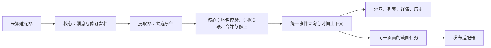

# 态势监控工具：模块化与插件化方案（讨论稿）

> 用途：帮助你决定产品方向与第一版范围。本文是重新推敲后的建议，尚未批准，也不表示功能已经实现。
>
> 上级入口：[项目说明](../README.md) · 既有基线：[设计讨论 v0](DESIGN.md) · 背景资料：[开源调研](RESEARCH-OPENSOURCE.md)
>
> 阅读建议：先看第 1、3、10 节作判断；其余章节解释实现边界和代价。

## 1. 我现在的建议

**做一个默认很简单、内部有明确扩展边界的事件地图工具。采用“模块化单体＋内置扩展＋专题配置”，第一版只实现确实要用的模块。**

Watchboard 吸引我们的部分，是围绕一个地区或专题，把地图、事件和时间组织起来。我们的核心用途则更集中：把 Telegram 消息持续变成可追溯的地图事件，必要时回看历史，并自动输出地图截图。

这次对上一轮建议作三处修正：

1. **不把每个界面组件都叫插件。** 地图、事件流、事件详情、统一时间筛选是同一个阅读流程，作为核心界面共同维护；折叠一个面板并不需要插件系统。
2. **把替换外部能力的地方做成扩展接口。** 消息来源、文本提取方式、附加数据图层、发布渠道确实会变化，值得独立实现。
3. **地区、类别与样式用配置表达。** “乌克兰”“炮击”“15 分钟后淡化”分别是专题、事件类型与显示规则，通常不需要新的可执行插件。

插件化会增加接口、启停、依赖和版本维护的工作量。它的价值应体现为：增加 RSS 时不修改事件合并；更换 AI 时不修改地图；关掉附加图层时不影响 Telegram 主流程。若只是把现有代码分进更多文件，却仍要到处改，就没有达到目的。

**默认体验仍然是一张地图和一列事件。扩展能力在需要时出现，后台处理有自己的明确开关。**

## 2. 以什么需求为基线

以下来自既有设计记录和本次对话；本稿延续它们，不把新建议写成已确认决议。

| 原始目标 | 对本方案的约束 |
|---|---|
| 监听约 4–10 个 Telegram 群／频道，每天几千条消息 | 先围绕一个运营者与一个地区设计；不为全球规模提前拆服务 |
| 消息转换为地点、事件类型、时间 | 地名解析、时间语义和可追溯性比增加面板更重要 |
| 多群重复消息合并，保留原始材料 | 合并规则和证据关系必须由核心统一管理 |
| 目标是消息发布后两分钟内可见 | 可定位的正常消息走快速路径；人工审核耗时与来源断流单独呈现 |
| 保留四类单点事件 | 延续爆炸、炮击、无人机袭击、导弹命中；仅报告发现或飞行方向的内容不自动映射为袭击／命中，是否纳入另行定义 |
| 时间衰减、历史留存与回看 | 淡出不删除；历史模式使用统一回看时间 |
| 事件触发截图并转发，默认至少间隔五分钟 | 自动输出保留在首版交付内；具体 Telegram／Discord 目的地仍待确认 |
| Quiet / Dense / Operational / Data-first | 装饰克制，地点优先，颜色有固定含义，错误状态能读懂 |
| 先词典规则，之后可接云端或本地 AI | 首版不依赖模型服务；提取器要可替换，但不承诺不同模型效果等价 |

“半公开链接”是原稿的访问方向，不是访问控制本身。只读查看与运营配置、审核、凭据管理必须有服务端权限边界；具体分享范围列为待决定问题。

## 3. 三条可走的路线

| 路线 | 能得到什么 | 主要代价 | 何时适合 |
|---|---|---|---|
| A. 在 Watchboard 上裁剪并接入采集 | 可能复用已有专题页面和部分展示能力 | 需先核实数据模型、更新方式与我们的实时流程是否匹配；裁剪后仍需维护上游变化 | 你希望尽量沿用它的完整产品形态 |
| **B. 自己的轻量核心，内置可替换模块** | 默认体验简洁，事件处理可控，逐项借鉴展示方式 | 要实现采集、证据与事件流程；扩展接口也需要维护 | **当前推荐：主要做 Telegram 区域事件监控** |
| C. 通用插件平台，支持第三方安装 | 插件可独立分发、升级，长期生态空间更大 | 需要安装、兼容性、权限、依赖冲突、隔离与恢复机制 | 已确定有外部开发者持续提供插件 |

推荐 B 是基于当前用途的产品判断，不是“自建必然更省工”的实测结论。若你最看重 Watchboard 的完整专题页面，A 仍值得做一次小规模接入验证后再比较。

本轮没有部署或完整审计 Watchboard，也没有证据能保证它的页面可以直接接上我们拟议的实时事件后端。

## 4. 哪些固定，哪些可扩展

### 4.1 核心：保证不同功能看到同一份事实

核心管理原始消息及修订、地名目录、候选事件校验、证据关联、去重与拆分、审核修正、历史版本、查询和实时更新。它还管理后台任务与模块状态。

消息与事件不是一对一：一条消息可能描述多个事件，多条消息也可能关联同一事件。因此单独保留消息—事件关联，指明所依据的消息修订、提取器及规则版本；重新提取不能直接覆盖人工修正，冲突进入待处理。

前端核心管理统一的查看条件结构：专题、地区、时间范围、事件类别、选中事件。同一视图内的地图、列表和详情共享上下文，不各自计算“当前时间”和“当前事件”。

人工截图采用当前视图；自动发布使用独立保存的发布视图配置，不跟随某个查看者的浏览状态。每次截图任务冻结查询时刻、范围与所用事件版本，再交给同一渲染页面生成。复用的是查询规则和页面，不是用户会话。

去重实现可以有内部策略接口，但第一版不开放任意插件改写已确认事件。否则两个插件可能对同一批消息给出两套互相矛盾的结果。

### 4.2 四类扩展边界

| 扩展类型 | 输入／输出职责 | 第一版 | 后续真实需求出现时 |
|---|---|---|---|
| 来源适配器 | 接收外部消息，带来源标识、外部消息 ID、时间与修订信息，交核心落库 | Telegram | RSS、文件导入、其他公开事件接口 |
| 提取器 | 从原始消息产生候选事件，附地名候选、时间依据、提取器版本 | 词典＋规则 | 云端模型、本地模型 |
| 附加图层模块 | 向统一地图贡献图层、图例和详情，声明时间覆盖、更新状态 | 核心事件与行政边界直接内置 | 警报区域、外部观测、聚合热力 |
| 发布适配器 | 接收已生成的截图／发布任务，发往指定目的地并报告结果 | 按已选目的地实现 Telegram 或 Discord；两者都需要则都做 | 其他发布渠道 |

这里的“插件”在第一版指开发者维护、随应用一起发布的受信任模块。新增可执行模块仍需要更新应用；配置启停不等于下载任意代码，也不等于独立热更新。

附加图层分两种：已有事件的热力展示只读核心数据；外部观测图层还需要对应的数据适配器。后者可作为一个功能包注册这两个部分，但数据接入和地图显示的开关仍需分开。

### 4.3 专题配置包：组合已有能力

“乌克兰监控”配置包包含默认地图范围、行政区与地名资源引用、类型名称、颜色、衰减规则、展示模块与来源配置引用。账户凭据保存在后台，不进入浏览器可下载的配置。

同一 Telegram 适配器可以有多个来源实例，不需要为每个群写一个插件。专题配置引用这些实例；关闭一个专题页面也不会自动关闭被其他专题使用的采集实例。

地区配置只能复用已有能力。换一个语言或地区，如果需要新词典、新语法规则或不同的数据接入，仍然有实际开发和校验工作，不能承诺“改一份 JSON 就全部完成”。

## 5. 用一条事件检验这套设计

例如收到“10 分钟前，赫尔松传出爆炸”的消息：

1. 来源适配器提交消息身份、原文、来源时间、系统接收时间与原始链接；核心先持久保存。
2. 提取器给出“赫尔松、爆炸、相对时间”的候选。相对时间通常以消息时间为基准解析，不能在一小时后重处理时又减十分钟。
3. 核心检查地名能否可靠对应、时间是否明确，以及是否与已有事件有关。位置只有城市级精度时，地图上的点必须表示城市级报告，不能暗示精确落点。
4. 同一内容在三个群转发，应能看到传播情况，但不能直接写成“三个独立来源证实”。分别保留消息条数、不同频道数和已辨识的来源关系；独立性未知就不宣称独立。
5. 新报告可更新已有事件；错误合并要能拆开，误报要能标记撤回。原始材料和修正理由保留，地图与列表同步更新。
6. 自动发布按保存的发布视图配置创建任务，冻结查询时刻、范围与所用事件版本；截图完成后交发布器发送，记录生成时间和发布状态。查看者切换历史不会改变该任务，历史补采的旧消息也不触发“刚发生”的自动播报。

**无法定位不能靠一个灰色点解决。** 没有可靠地理候选的消息应进入“待定位”，可在运营列表中看见，不在地图上猜一个位置。有位置但事件真实性未确认的报告，是另一种状态。地名可信度与事件核验状态应分开表达。

### 两种历史要区分

- **首版历史回看**：按事件发生时间看一个过去时段，采用目前最新的修正结果。可标注“包含后续修正”。
- **当时态重现**：严格还原某个时刻系统当时知道什么，需要按接收时间和事件版本重建，成本更高。

推荐首版交付前者，保留原始修订和事件修正记录，为后者留下数据基础；不将前者称为精确重现当时屏幕。

## 6. 用户看到的界面

### 默认查看

顶部细工具栏显示专题、实时／历史状态和必要的来源健康信息。主体是地图与右侧事件流。地点是首要信息，其次事件类型，再次时间和报告数量。详情按需展开，显示原始材料与修正状态。

宽屏以约 84% 地图、16% 事件栏作为目标比例；窗口变窄时优先确保列表可读并支持收起。比例是视觉目标，不以截断地名或挤压地图为代价。

历史模式打开时间控制条；地图和列表共同切换，点的时间衰减相对选定的回看时刻计算。实时采集可在后台继续，新到消息不强行打断用户正在看的历史。

### 扩展入口

查看者使用“图层”和“视图”选择要看的内容。运营者在设置里管理来源、提取方式与发布渠道。第一版不需要一个展示大量未实现功能的“插件商店”。

| 操作 | 实际效果 |
|---|---|
| 隐藏图层／收起面板 | 停止相应展示，可停止仅该视图使用的前端订阅；其他视图和后台采集不受影响 |
| 停用来源实例 | 停止该实例接收新消息；旧数据保留，相关任务按启停规则处理 |
| 停用 AI 提取器 | 不再调度新的 AI 请求；词典路径继续，已返回候选仍经核心校验 |
| 暂停发布渠道 | 不再领取新的发送任务；历史发送记录保留，处理中任务如实显示 |
| 卸载模块代码 | 属于应用版本变更，需检查依赖；第一版不在网页上提供卸载功能 |

外部图层没有历史数据时，在历史模式明确标注“无该时段数据”并隐藏，不能把最新数据混入过去的地图。

若停用的是当前唯一提取器，采集可继续保存原始消息，但未提取材料必须显示为积压；重新启用后继续处理，不能静默丢弃。

## 7. 插件背后的最低工程约定

这些是建议中的实现要求，不是已有能力。目标是使扩展可理解、可停止、可恢复。

**统一接口。** 每个模块登记 ID、类型、接口版本、配置结构、依赖和健康检查。来源提交原始消息；提取器提交候选；发布器领取发布任务。业务写入经核心服务完成。接口版本只需维护应用内兼容性，第一版不建立复杂的第三方版本协商。

**明确状态。** 至少区分未配置、停用、运行中、处理中断和错误；显示最近成功同步时间及失败原因。“没有新事件”和“来源断了”必须可区分。

**停用与恢复有边界。** 来源在消息持久化后保存处理游标。停止后不接收新的任务，处理中任务安全完成或在超时后释放；再次启动从检查点恢复，并标识补采时间段。来源无法补齐的时间段必须显示缺口。

**任务可以重试，但不能假定只执行一次。** 使用稳定消息身份、任务身份和发布记录减少重复；进程崩溃后能继续处理未完成工作。第三方发送成功但本地未收到确认时，标记“发送结果待确认”，不无限重试刷屏，也不承诺跨服务严格只发送一次。

**模块共享进程不是强隔离。** 异步任务的超时、取消、异常处理只能控制部分失败；CPU 阻塞、内存耗尽仍可能影响同进程。截图浏览器放在独立工作进程；模型和外部请求设置时限。需要更强稳定性的采集模块再放到独立进程，而不是每个模块默认一个容器。

**模型调用有单独权限与预算。** 开启云端提取器时，明确哪些来源允许发送文本、调用额度和失败后的处理方式。本地模型与云端模型共享候选结构，但切换后要用同一批样本检查提取质量。

**权限由服务端执行。** 半公开页面只能查看允许公开的事件投影。来源账户、原文可见范围、审核、启停与发送权限属于运营面；仅把按钮藏起来不能完成隔离。

## 8. 部署也应跟着简化

原稿按 ingest、extract、api、web、bot 等模块列了较多容器。建议先按运行特性分组，而不是把插件数等同于服务数：

| 运行单元 | 职责 |
|---|---|
| 应用服务 | API、实时推送、运营接口与构建后的前端 |
| 后台工作进程 | 来源采集、词典提取、事件处理与任务调度；内部任务受管理 |
| 截图／发布工作进程 | 独立浏览器资源、截图生成与发布任务 |
| PostgreSQL／PostGIS | 消息、事件、关系、修订及持久任务的统一存储 |

这是建议的起步拓扑，需用实际消息样本与目标机器验证。Telegram 连接或工作负载若需要独立恢复，可将采集单独运行，不改变数据接口。

**Redis 与专用快照表不应仅因“以后会大”就成为首版前提。** 可以先验证带索引的时间范围查询和 Postgres 持久任务表是否满足负载。持久任务需要事务落库、领取租约、超时回收和重试上限；这部分复杂度仍然存在，只是先不增加另一套基础设施。实时推送从持久变更记录恢复，数据库通知若使用，也只作唤醒信号。

若事件查询或任务吞吐实测不足，再增加缓存、快照或专用队列。这是对原稿的待确认简化建议，不是性能保证。

开发端口延续项目约束：前端 5173、API 8000；若引入 Redis，本机用 6398。3003、3004 和 6399 为 Clowder 保留，不使用。

## 9. 第一版如何交付和验证

### 第一版完整范围

一个乌克兰专题；Telegram 来源配置；词典与规则提取；原始消息及编辑修订留档；候选校验与可修正的合并；待定位／待核验处理；地图、列表和来源详情；统一时间筛选与历史回看；同页截图；已选发布渠道；基本健康状态、检查点恢复与备份恢复检查。

四类扩展接口随这些实际模块一起定义。附加外部图层、AI 摘要和第二种模型实现不会为了“显得有插件系统”提前造出来。

### 实施顺序，不等于三次缩减承诺

| 步骤 | 可评估的成果 | 通过后才进入下一步的依据 |
|---|---|---|
| 1. 固定样本验证事件流程 | 用含转发、错地名、模糊时间和编辑的样本，贯通存储、提取、合并与查看 | 结果可追溯，误报可纠正，时间和计数语义一致 |
| 2. 接入真实来源 | 小范围运行 Telegram 采集与实时界面 | 看得到连接状态、延迟、断线恢复与未处理积压 |
| 3. 完成历史与发布闭环 | 可回看、可审核修正、可截图发送 | 历史不串入最新外部数据，补采不乱发通知，发送失败可处理 |

第一版完成指三个步骤的目标闭合。只做好漂亮页面或完成接口定义，都不代表原始目标完成。

### 接受标准

- **速度**：正常可定位消息以源消息发布时间到界面可见时间衡量两分钟目标，同时记录接收、处理、可见三个时刻。来源不可用、人工待处理与补采单独统计，不能用缩小统计范围掩盖延迟。
- **提取质量**：共同确认一组真实代表样本与期望结果，分别看类型、地名、时间与合并正确性。接受阈值在样本确认后设定，不凭空承诺准确率。
- **不确定性**：无法定位的消息可查但不乱落点；城市级坐标不会显示成精确命中；转发数不会冒充独立证实数。
- **一致性**：地图、列表、详情、历史与截图在同一时间条件下吻合；修正、撤回与拆分可传播。
- **恢复**：来源断线、程序重启后可继续处理；恢复缺口与重复材料可辨识；备份实际能恢复。
- **可控性**：分别验证隐藏图层、停用采集、停用提取器与暂停发布；停用不能只改变按钮颜色。
- **输出**：按已选目的地完成截图发送、限流与失败记录；五分钟节奏不会被重试和补采绕过。

## 10. 留给你考虑的五个决定

这里需要的是产品取舍，不需要你决定目录结构、注册表写法或数据库索引。

| 需要决定的事 | 我的建议 | 选择另一方向意味着什么 |
|---|---|---|
| 产品主要是实时事件地图，还是 Watchboard 式专题门户？ | 实时事件地图为主，专题背景以后作为独立阅读视图 | 专题门户需要更多背景资料、摘要和内容维护，地图占比也可能变化 |
| 扩展由我们维护，还是允许别人安装第三方插件？ | 受信任内置模块，统一发布 | 第三方安装需要额外的兼容性、权限与隔离设计 |
| “历史”要看最新修正后的过去事件，还是精确还原当时系统认知？ | 首版提供最新修正后的历史，保留修订基础 | 当时态重现需要更完整的版本查询、规则与界面说明 |
| 未确认内容和原文给谁看？ | 运营者可查所有待处理材料；共享地图只看明确允许展示的投影 | 对外显示未确认报告需有清晰标记和展示规则；原文范围影响权限设计 |
| 第一版实际发布到哪里？ | 确认 Telegram、Discord 或两者后实现；保留截图自动输出 | 两者都要就都纳入首版验收，不能仅留接口当成交付 |

建议先决定前两项，它们决定这应当是一个专注工具，还是一个更广的内容与插件平台。其余三项可以随样本和发布场景继续细化。

## 附录 A：相对上一轮和旧设计的变更

| 之前的表达 | 本稿的修正及理由 |
|---|---|
| 地图、时间线、事件流都做面板插件 | 作为核心联动体验；折叠显示足够，避免插件互相同步状态 |
| 类型和地区都能用配置扩展 | 配置只组合已有能力；新语义和新语言仍需实现与验证 |
| 未匹配地名也即时上图并标灰 | 无可靠位置先待定位；“未定位”和“未核验”分开 |
| 三个群报告就是三次独立报告 | 分离消息数、频道数、来源关系，避免把传播误当交叉证实 |
| 只靠筛选就“免费获得”历史回放 | 筛选可实现历史查看；精确还原当时认知另需版本语义 |
| 每个模块对应一个容器，默认 Redis＋快照 | 按运行特性分组，缓存和快照以测量结果决定 |
| 插件失败不影响系统 | 明确进程内错误处理的边界，浏览器等重任务独立运行 |
| 所有建议可直接作为新架构 | 本文保持 proposed，待你考虑后再修订正式设计 |

## 附录 B：依据、限制和文档状态

- **本地产品依据**：[README](../README.md) 与 [DESIGN](DESIGN.md)，本轮已阅读。原稿中的第三方维护状态、性能、许可和“没有同类项目”等结论，没有在本轮逐项复核，不作为本提案成立的前提。
- **外部参考**：[Watchboard 官方 README](https://github.com/ArtemioPadilla/watchboard/blob/main/README.md)，查阅日期 2026-09-06。其说明使用专题配置和数据目录，并提供地图、来源分级与专题更新能力。本稿只据此借鉴产品组织思路；不据 README 宣称它已有独立插件生命周期，也不承诺代码可直接复用。
- **证据边界**：本次是方案文档，未进行 Watchboard 部署、完整源码审计、接入实验或性能测试。具体技术包版本与维护状态在实施选型时核验。
- **变更范围**：只新增这份讨论稿，既有设计、调研和原型文件保持原样；未改生产代码、账户配置或运行服务。
- **落地状态**：尚未正式立项、采纳或取代旧设计。因当前目录属于父级 Git 仓库，本次不把整套现有未跟踪文件打包提交，也不执行远端发布。

### 收敛检查

1. 否决理由 → ADR？没有正式否决；备选路线及不推荐的理由保留在第 3 节，待决定后再登记正式决议。
2. 踩坑教训 → lessons-learned？没有新增运行事故或已验证教训；本稿列的是设计风险与建议。
3. 操作规则 → 指引文件？没有新增治理规则；未修改 AGENTS.md、SOP 或技能文件。
